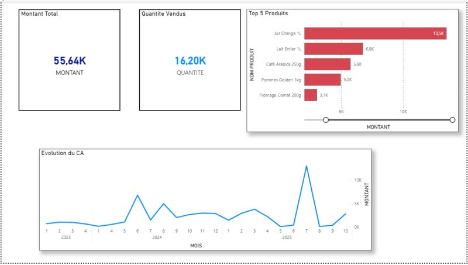
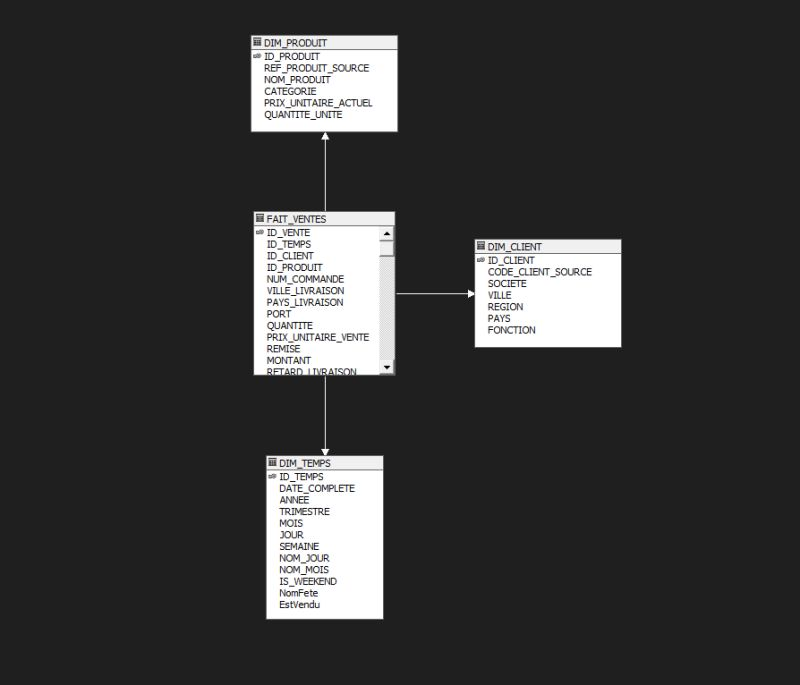
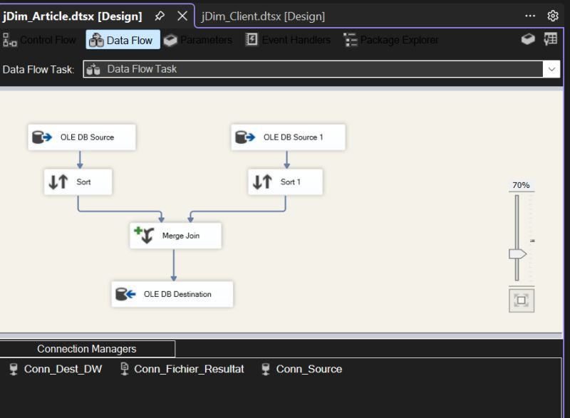
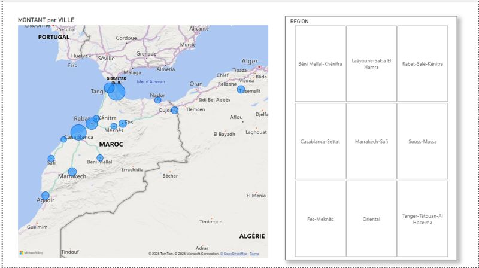
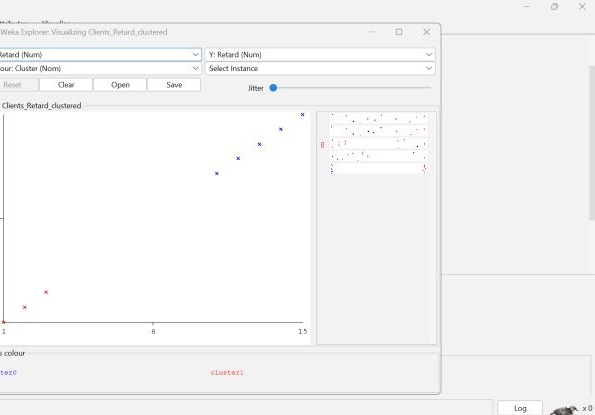
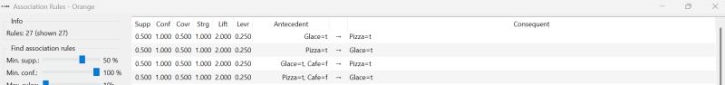

# Comptoir Analytics — BI & Data Mining

Projet académique d’analyse des performances commerciales : intégration de données avec **SSIS**, modélisation d’un entrepôt en étoile, cube **SSAS**, reporting **Power BI** et exercices de **data mining** avec Weka et Orange.

**SQL Server · SSIS · SSAS · Power BI · Weka · Orange Data Mining**



## Objectif

Passer des commandes et lignes de commande à une lecture des ventes par période, produit, client et zone géographique. Un volet complémentaire explore la segmentation des clients et les associations entre produits.

Ce dépôt rassemble les **sources historiques disponibles et les captures de réalisation**. L’environnement n’a pas été réexécuté pour cette publication ; ce n’est pas une démonstration en ligne ni une restauration clé en main.

## Architecture

```text
Base transactionnelle Comptoir
          │
          ▼
    Packages ETL SSIS
          │
          ▼
 Entrepôt de données en étoile
          │
          ▼
      Cube SSAS ───► Reporting Power BI

Échantillons CSV/ARFF ───► Weka : segmentation des clients
Panier_Produits.csv ─────► Orange : règles d’association
```

### 1. Intégration et entrepôt de données

Quatre packages SSIS alimentent les dimensions et les faits :

| Package | Rôle visible dans les sources |
| --- | --- |
| `P_Dim_Client.dtsx` | Chargement de la dimension client |
| `P_Dim_Produit.dtsx` | Tri et jointure des produits et catégories, puis chargement de la dimension produit |
| `P_Dim_Temps.dtsx` | Construction de la dimension temps avec un composant Script et des colonnes dérivées |
| `P_Fait_Ventes.dtsx` | Jointures des commandes et produits, traitement de valeurs manquantes et lookups vers les dimensions |

La requête du package de faits calcule notamment des montants brut/net et le délai entre commande et livraison. Sa copie lisible est disponible dans [`sql/fact_sales_source.sql`](sql/fact_sales_source.sql).





### 2. Analyse multidimensionnelle et reporting

Le projet SSAS contient le cube `Cube_Ventes`, une vue de source de données et trois dimensions : **Client, Produit et Temps**. Les mesures présentes couvrent notamment montant, quantité, remise et délai de livraison.

Le rapport [`first_bi_project.pbix`](power-bi/first_bi_project.pbix) contient trois pages : **Performance Commerciale**, **Analyse Géographique** et **Analyse Temporelle**. Il utilise une connexion **live** à la base SSAS `Projet_Cube_Comptoir`, cube `Cube_Ventes`, sans modèle de données embarqué.

Les captures Power BI illustrent le suivi des montants, les produits les plus vendus, l’évolution temporelle et la répartition géographique des ventes. Le fichier original est conservé sans modification ; son ouverture interactive dépend de l’accès au cube et de la reconfiguration de la connexion au serveur d’origine.



### 3. Data mining

- **Weka / K-means** : segmentation des clients sur les variables `Retard` et `Nombre`. Le CSV et un ARFF contenant une colonne `Cluster` sont fournis. Le modèle entraîné et son paramétrage complet ne sont pas inclus.
- **Orange / Apriori** : workflow de recherche de règles d’association sur un petit panier de produits. Cet échantillon pédagogique est distinct des lignes de vente du cube ; aucune extraction automatique entre les deux n’est fournie.





## Organisation du dépôt

```text
.
├── etl/Projet_BI_Comptoir/         # Sources SSIS et projet SSDT
├── olap/Projet_Cube_Comptoir/      # Cube, dimensions et projet SSAS
├── data-mining/
│   ├── clustering/                # Échantillons CSV et ARFF Weka
│   └── association/               # Workflow Orange et panier de produits
├── power-bi/                      # Rapport PBIX original en connexion live SSAS
├── sql/                           # SELECT extrait du package de faits
└── docs/
    ├── RESTAURATION.md            # Prérequis, réglages et limites de reprise
    └── screenshots/               # Captures de la réalisation historique
```

## Consultation et reprise

Le dépôt peut être consulté sans installer la stack BI : commencer par les captures, la requête SQL et les sources XML des projets. **VS Code sert à parcourir les fichiers et gérer Git ; il ne remplace pas Visual Studio/SSDT pour exécuter SSIS ou SSAS.**

Pour une reprise technique, voir [`docs/RESTAURATION.md`](docs/RESTAURATION.md). Le projet SSIS déclare une cible **SQL Server 2022** et utilise le fournisseur historique `SQLNCLI11.1` ; les connexions et composants devront être adaptés à l’environnement disponible.

## Périmètre et limites

- Les scripts complets de création/chargement des bases ne sont pas fournis. Le `.pbix` est présent, mais sa connexion live nécessite un cube SSAS disponible : il ne constitue pas un export autonome des données.
- Le champ historique `RETARD_LIVRAISON` est calculé dans l’ETL par `DATEDIFF(day, DATE_COMMANDE, DATE_LIVRAISON)` : il mesure ici un **délai commande–livraison**, pas un dépassement d’une date de livraison promise.
- Les résultats de mining portent sur des échantillons pédagogiques ; ils ne constituent pas une validation prédictive sur des données de production.
- Dans les sources XML SSIS/SSAS, les noms de serveurs ont été remplacés par `YOUR_SQL_SERVER` et les métadonnées de poste nettoyées. Les libellés clients des CSV/ARFF ont été remplacés par des identifiants neutres, sans recalculer les valeurs numériques. Le `.pbix` original conserve, lui, la référence à son serveur d’origine ; aucun identifiant ni mot de passe n’apparaît dans sa chaîne de connexion.
- L’historique de chemins locaux du widget File d’Orange a été réinitialisé : sélectionner de nouveau `Panier_Produits.csv` lors de l’ouverture du workflow.
- Le PDF de l’archive est le sujet pédagogique, pas un rapport de réalisation ; il n’est pas redistribué dans ce dépôt.

## Contexte

Projet réalisé dans le cadre du Master d’Excellence en Ingénierie Logicielle à la Faculté des Sciences d’Agadir.

[Aperçu partagé sur LinkedIn](https://lnkd.in/p/exjDvNaY)
